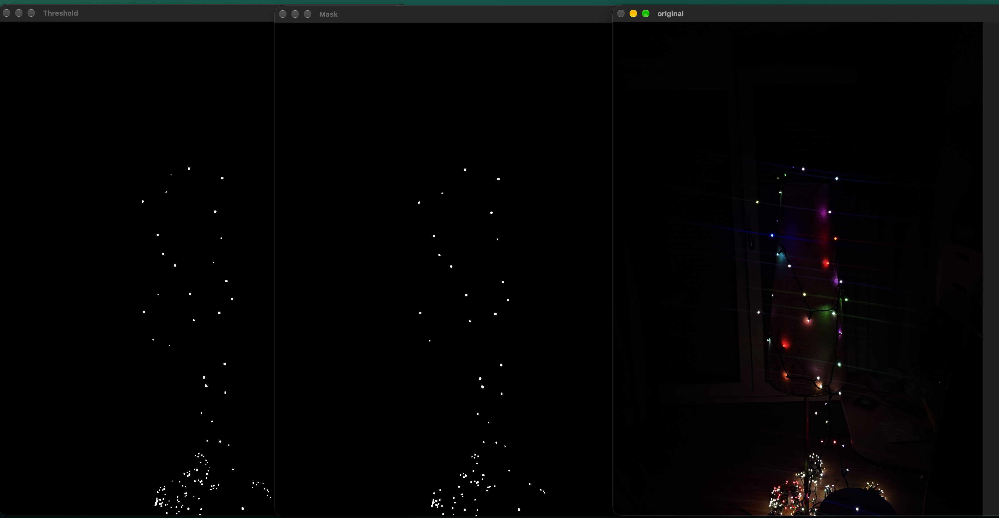

# xmas-mapper

Scan a Christmas tree's LED string into a 3D point cloud, then play effects that use
where each LED actually sits on the tree.

Hardware: Govee H6870 / H6871 Christmas tree string light (250/375 addressable LEDs),
controlled over its encrypted BLE protocol. See [H6871.md](H6871.md) for the protocol.

[](led-detection/v1.png)

## Setup

```sh
python -m venv venv && source venv/bin/activate
pip install -r requirements.txt
```

## Usage

```sh
python main.py                          # list tools
python main.py leds --scan              # find the light
python main.py leds --fill ff0000       # whole tree red
python main.py leds --on 0-9 --color 00ff00
python main.py test-rainbow             # light test
```

Run `python main.py leds --help` for all options.

## Web UI

```sh
python main.py ui              # http://localhost:8000: light control + LED detection runs
python main.py ui --reload     # dev: server restarts and the page reloads on every edit
```

Docker (Linux host such as a Raspberry Pi only; BLE goes through the host's BlueZ):

```sh
docker compose up -d                                                  # http://<host>:8000
docker compose -f docker-compose.yml -f docker-compose.dev.yml up     # dev, hot reload
```
